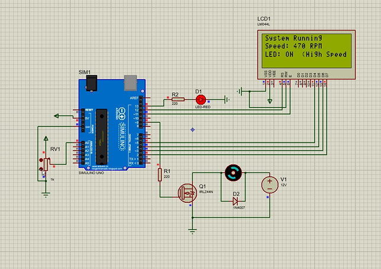

# Industrial Motor Speed Controller

[](https://www.arduino.cc/)
[](https://www.labcenter.com/)
[](https://isocpp.org/)

## Executive Summary

An Arduino Uno prototype for controlling a DC motor using a potentiometer and a MOSFET-based PWM power stage.  
The firmware maps the potentiometer input to motor drive and an estimated RPM display, and turns on an LED at the high-speed threshold.

## Hardware & Components

| Component | Connection / role |
|---|---|
| Arduino Uno | Main controller |
| Potentiometer (RV1) | Wiper to **A0**; sets the requested speed |
| DC motor and 12 V supply | Motor switched by an **IRLZ44N** MOSFET from PWM pin **D9** |
| Flyback diode (1N4007) | Connected across the motor for inductive-load protection |
| 20×4 character LCD | `LiquidCrystal` parallel interface: **RS D12**, **E D11**, **D4–D7 on D5–D2** |
| LED indicator | **D13** through a current-limiting resistor |
| Gate resistor | **220 Ω** between D9 and MOSFET gate (as shown in the circuit) |

## System Architecture & Logic

The potentiometer is sampled on **A0** (10-bit ADC, 0–1023), then scaled to an 8-bit PWM command (0–255) for **D9**. The same input is mapped to **0–470 RPM** for display; this is a simulated estimate, not a measurement from a motor speed sensor. The LCD refreshes every 200 ms. At an estimated speed of **230 RPM or higher**, the firmware switches on the D13 LED and shows the high-speed status; otherwise, the LED is off.

## Circuit Simulation & Demo



> **▶ Simulation walkthrough:** [Watch Full Proteus Simulation Demo](https://youtu.be/3u_rVZBT7XM)

## Repository Layout

```text
.
├── assets/                 # Project interface image
├── docs/                   # Project report
├── firmware/
│   ├── prebuilt/            # Ready-to-load Proteus firmware
│   └── project_final/       # Arduino sketch
├── simulation/             # Proteus project
├── .gitignore
└── README.md
```

## How to Run (Simulation Setup)

1. Open [`simulation/finalP.pdsprj`](simulation/finalP.pdsprj) in Proteus.
2. Open [`firmware/project_final/project_final.ino`](firmware/project_final/project_final.ino) in Arduino IDE and select **Arduino Uno**.
3. Compile the sketch if you want to rebuild the firmware. A ready-to-load HEX is included at [`firmware/prebuilt/controller.hex`](firmware/prebuilt/controller.hex).
4. In Proteus, edit the Arduino model's **Program File** property and browse to `firmware/prebuilt/controller.hex`. The project file originally stored a machine-specific absolute HEX path, so this must be set again when opening the project on another computer.
5. Run the simulation and adjust the potentiometer to vary the PWM output and displayed speed.

The project report is available at [`docs/Final_Project_Report.pdf`](docs/Final_Project_Report.pdf). Generated Arduino build outputs are kept locally under `firmware/project_final/build/` and excluded from version control.
